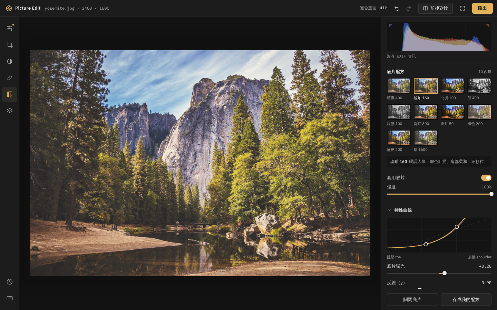

# 暗房 · Picture Edit

在瀏覽器裡跑的非破壞式照片編輯器，可以把它想成輕量版的 Lightroom。照片不會上傳到任何地方，所有運算都在你的電腦上完成（WebGL2 + Web Worker）。



## 快速開始

```bash
npm install
npm run dev            # 開發伺服器
npm run build          # 型別檢查 + 打包到 dist/
npm run build:single   # 打包成單一 HTML 檔（dist-single/index.html），雙擊就能用
```

拖曳照片進視窗、按 `Ctrl O`，或直接貼上（`Ctrl V`）。也可以點空白畫面上的「試用範例照片」。

## 功能

| 區塊 | 內容 |
| --- | --- |
| 匯入 | JPEG / PNG / WebP（Safari 另可讀 HEIC），讀取 EXIF（相機、鏡頭、光圈快門 ISO、方向） |
| 基本調整 | 曝光、對比、亮部、陰影、白色、黑色、色溫、色調、自然飽和度、飽和度、清晰度、去霧、自動色調 |
| 色調曲線 | RGB 與 R / G / B 個別曲線，可拖曳控制點（單調三次插值，不會過衝） |
| HSL | 8 個色相各自調色相、飽和度、明度 |
| 分離色調 | 亮部 / 陰影色相與飽和度、平衡 |
| 裁切與幾何 | 原始 / 自由 / 1:1 / 4:5 / 3:2 / 16:9（可切直橫）、90° 旋轉、水平 / 垂直翻轉、拉直滑桿、**自動拉直**、刻度盤式拉直尺規 |
| 底片模擬 | 10 種虛構底片配方，每個物理參數都能調，調好可存成自己的底片 |
| 局部遮罩 | 筆刷（含擦除、羽化、流量）、線性漸層、徑向漸層，最多 8 個，每個遮罩有自己的一組調整 |
| 修補 | 污點修復（自動找來源、亮度色彩自動校正）與仿製印章 |
| 檢視 | 即時直方圖、前後對比分割線、按住看原圖、縮放平移、雙指縮放、全螢幕 |
| 紀錄 | 完整歷史紀錄（可點回任一步）、快照、複製 / 貼上設定 |
| 預設集 | 7 個內建風格，可自存；設定可匯出成 JSON 再載入 |
| 匯出 | JPEG / PNG / WebP、品質、長邊尺寸，一次匯出多張（批次） |
| 手機 | 底部抽屜面板、快速滑桿列、雙指縮放 |

所有編輯都存成一份 JSON（`EditState`），原圖從不被改動。

## 快捷鍵

按 `?` 可隨時叫出快捷鍵面板。

| 動作 | 按鍵 |
| --- | --- |
| 工具：調整 / 裁切 / 遮罩 / 修補 / 底片 / 預設集 / 歷史 | `A` `R` `M` `J` `N` `P` `H` |
| 復原 / 重做 | `Ctrl Z` / `Ctrl ⇧ Z` |
| 複製 / 貼上設定 | `Ctrl ⇧ C` / `Ctrl ⇧ V` |
| 匯出 / 開啟 | `Ctrl E` / `Ctrl O` |
| 適合畫面 ↔ 100% | `Z` |
| 縮放 / 適合畫面 | `Ctrl +` `Ctrl −` / `Ctrl 0` |
| 平移 | 按住 `Space` 拖曳 |
| 前後對比分割線 | `Y` |
| 按住看原圖 | `\` |
| 隱藏右側面板 / 全螢幕 | `Tab` / `F` |
| 完成裁切 | `Enter` |
| 顯示遮罩範圍 | 按住 `Alt` |
| 筆刷大小 / 擦除 | `[` `]` / 按住 `Alt` 塗抹 |
| 新增筆刷 / 線性 / 徑向遮罩 | `B` / `G` / `O` |
| 刪除選取的遮罩或修補點 | `Delete` |

滑桿：**雙擊歸零**、拖曳時顯示數值、`⇧` 拖曳微調、方向鍵逐格、點數字可直接輸入。

## 底片模擬是怎麼做的

這裡不是套一張 LUT，而是用簡化的物理模型模擬「光打在底片上、再印到相紙」的過程。每個步驟都在線性光（linear light）裡算，最後才轉回 sRGB。

1. **曝光量進入 log 域**
   底片對光的反應是對數的，所以先把線性亮度轉成相對於 18% 灰的「檔數」：`s = log₂(x / 0.18) + 底片曝光`。

2. **層間串色（crosstalk）**
   彩色底片有三層感光乳劑，各層的染料並不純，會互相吸收一點別人的光。用一個 3×3 矩陣把三個通道互相混一點，這就是底片色彩「黏在一起」、比數位柔和的原因。之後在 log 域調整飽和度。

3. **特性曲線（H&D 曲線）**
   中段是一條斜率 = gamma（反差）的直線；往暗部用 `tanh` 平滑地漸近到「片基＋霧度」（**趾部**），往亮部漸近到紙白（**肩部**）。
   `Y = log₂(0.18) + R · tanh(gamma · s / R)`，R 在暗部、亮部各自由「趾部」「肩部」參數決定。
   這讓高光不會像數位那樣硬生生剪掉，而是慢慢收進去。

4. **相紙白點補償**
   純粹的肩部會把整張照片壓灰（原本 240 的白只剩 211 左右）。所以額外算出「輸入的白點」在曲線上落在哪，再用一個平滑的二次權重把它推回 1.0。肩部只負責「亮部怎麼收」，不會讓白變灰。

5. **三層各自的偏移與反差**
   R / G / B 三層各有曝光偏移（`layerOffset`）與 gamma 倍率（`layerGamma`）。暗部與亮部因此會往不同顏色跑，例如暗部偏青、亮部偏暖，這就是底片「交叉色偏」的來源。

6. **褪色**：把黑位往上抬，模擬片基霧度與相紙的最暗黑。

7. **顆粒**
   多個尺度的雜訊疊加。顆粒強度跟亮度有關：中間調最明顯，純黑與純白幾乎沒有，這跟真實銀鹽顆粒一樣。ISO 決定顆粒大小與強度的基準，還能調整彩色顆粒的比例。縮小預覽時會依縮放比例衰減，避免縮圖看起來全是雜訊；匯出時用原尺寸算。

8. **高光暈染（halation）**
   強光穿過底片、從片基背面反射回來，再曝一次紅色層，所以亮點周圍會有一圈**紅橘色**光暈。做法是取出亮部、在 1/4 解析度做可分離的高斯模糊，染成紅色後加回去。另有不帶色的柔光（bloom）。

9. **暗角、漏光、片框**：暗角在曝光域裡做，交給肩部自然收；、可換隨機種子的漏光，以及帶圓角、邊緣略不規則的片框（rebate）。

黑白底片會先用可調的「濾鏡」權重（R / G / B 對亮度的貢獻）把彩色轉成單一通道，再走同一條曲線。

內建 10 種底片全是**虛構的**乳劑，數值是照那種感覺的物理特性去調，不是模仿任何商品：

晴嵐 400、琥珀 160、北境 100、墨 400（黑白）、銀鹽 100（黑白）、霓虹 800、正片 50、褪色 200、盛夏 200、霧 1600。

右側的特性曲線圖會即時畫出目前參數的 R / G / B 曲線。

## 架構

```
src/
  core/        與介面無關的處理核心（未來包成 Tauri 桌面版可直接沿用）
    state.ts      EditState：可序列化、帶版本號
    film.ts       底片曲線與內建配方（和 shader 用同一個公式）
    geometry.ts   裁切、旋轉、拉直的仿射矩陣
    analysis.ts   自動拉直（方向限定的霍夫轉換）、修補來源搜尋
    worker.ts     解碼、EXIF、縮圖、分析、匯出編碼都在 Worker 裡
    gl/           WebGL2 渲染管線與 shader
  ui/          介面（原生 TypeScript + CSS，無框架）
```

渲染管線：sRGB 來源（含 mipmap）→ RGBA16F 線性顯影（基本調整、曲線、HSL、遮罩、修補）→ 高光暈染 → 底片 → sRGB 輸出 → 顯示（縮放、前後對比）。預覽只算螢幕需要的解析度，放大到 100% 才用原尺寸。

設計細節見 [DESIGN.md](DESIGN.md)，開發計畫與進度見 [PLAN.md](PLAN.md)、[PROGRESS.md](PROGRESS.md)。

## 測試

```bash
npm test                    # 單元測試（曲線、幾何、底片單調性、歷史、EXIF、自動拉直…）
npm run test:gl             # 在 Chromium 實際跑 shader：所有參數歸零時輸出 = 輸入（最大差 1/255）
npm run screenshots         # 用 Playwright 產生 screenshots/ 的介面截圖
node e2e/interact.mjs       # 互動測試：拖滑桿、復原、筆刷、修補、裁切、多張照片、匯出
```

## 已知限制

- **自動拉直**在有明確地平線、建築或直線的照片上很準；純自然景物（山、樹林）沒有可靠的直線，可能判斷不出來或判錯，這時請用拉直尺規手動調。
- **HEIC** 只有瀏覽器本身支援時才能開（目前是 Safari）。
- 效能目標是 2400 萬畫素維持 30fps 預覽。預覽只算螢幕解析度，所以一般調整很順；但這次只在無 GPU 的測試環境（軟體渲染）驗證過正確性，**還沒在實體顯示卡上量過 24MP 的實際幀率**。
- 歷史紀錄與快照存在記憶體中，關掉分頁就沒了；自存的底片與預設集存在瀏覽器 localStorage。

## 致謝

範例照片 `public/samples/yosemite.jpg` 由 Christian Joudrey 拍攝，來自 Unsplash（經由 picsum.photos）。

介面字型：IBM Plex Sans / IBM Plex Mono（SIL Open Font License）。
